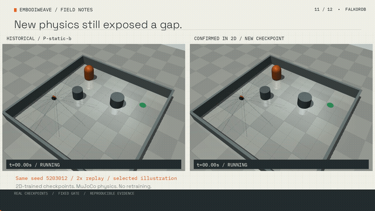
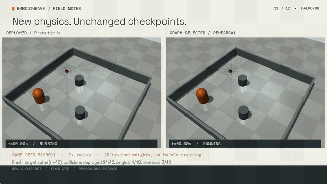
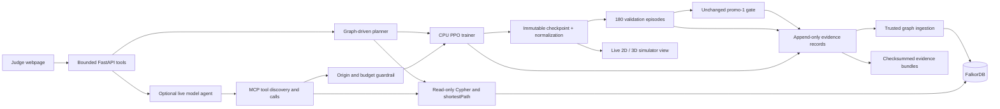

# EmbodiWeave

An agent that reads a robot's training history in FalkorDB, decides which checkpoint to retrain, launches training, and proves whether the new policy got safer.

**[Live demo](https://embodiweave.52.202.25.181.sslip.io) · [Judge walkthrough](https://embodiweave.52.202.25.181.sslip.io/robustness.html) · [2-minute film](https://embodiweave.52.202.25.181.sslip.io/media/embodiweave-demo-v3.mp4) · [Train in your browser](https://embodiweave.52.202.25.181.sslip.io/live.html#training)**

[](https://github.com/himanshu748/embodiweave/actions/workflows/tests.yml)

GraphHacks Track 01: **Agents That Act on Connected Data**.

## Why Track 01

| Focus | Concrete implementation |
|---|---|
| Multi-hop reasoning | [`DERIVED_FROM*1..8` query](ew/graph/queries.py), [actual returned ancestor paths](evidence/mcp-agent-v2/algorithm.json) |
| Graph queries and algorithms as tools | [Exact native `shortestPath` Cypher](evidence/mcp-agent-v2/nearest-passing-ancestor.cypher), bounded and unweighted |
| Tool selection through MCP | [Actual model and four MCP calls](evidence/mcp-agent-v2/agent-receipt.json), [stdio + HTTP server](ew/mcp_server.py) |
| Actions based on graph evidence | [New public PPO run, 180 validation episodes and gate](evidence/mcp-agent-v2/training-receipt.json), [checkpoint bundle](evidence/mcp-agent-v2/repro-v3.zip) |
| Explainable results | [Decision `deci-20261016121309-c0c93f`](evidence/mcp-agent-v2/decision.json): model, calls, Cypher, parameters, candidates, guardrail and revision, saved before training |

**[Let the live agent choose and train](https://embodiweave.52.202.25.181.sslip.io/live.html#investigate)**. It discovers domain tools over MCP and proposes its own origin; the guardrail can veto but does not replace that choice with rank one. A separately labelled deterministic MCP fallback handles inference failure on an explicitly consented training task. FalkorDB failure still stops planning. [Protocol, tool contract and client setup](docs/MCP.md).

### Recorded public agent action

GPT-4.1 Mini used MCP, read FalkorDB's shortest-path result, chose `physics-20261016150004-25da9c` and launched **60,000 requested / 61,440 consumed PPO steps**. Its new checkpoint passed **4/4 suites across 180 validation episodes**. Collision counts were target **3/60** (10% limit), open **0/40** (5%), static **1/40** (10%) and crossing **1/40** (15%).

**The gate passed, but target and crossing collisions were worse than the chosen parent's 2/60 and 0/40. No safety improvement is established.** The default demo policy stays unchanged. This action demonstration is separate from the frozen studies below. [Full result, exact hashes, provider usage and evidence](evidence/mcp-agent-v2/). The earlier [provider-down deterministic fallback](evidence/mcp-agent-v1/) is retained and labelled.

### Connect MCP from Claude Desktop or Cursor

Run `docker compose up --build` first, then configure a stdio server using your checkout's absolute Compose path:

```json
{"mcpServers":{"embodiweave":{"command":"docker","args":["compose","-f","/absolute/path/embodiweave/compose.yaml","exec","-T","embodiweave","/app/.venv/bin/python","-m","ew.mcp_server"]}}}
```

Claude Desktop uses `claude_desktop_config.json`; Cursor uses `.cursor/mcp.json`. Cursor's HTTP form is `{"mcpServers":{"embodiweave":{"url":"https://embodiweave.52.202.25.181.sslip.io/mcp/"}}}`. Public HTTP connections can read; training needs the webpage's separate consent. [Local training opt-in, standalone HTTP and optional official FalkorDB MCP](docs/MCP.md).

## Current result: confirmed in 2D

**The new graph-selected checkpoint passed all four unchanged validation suites and one fresh, preregistered confirmation batch.** Target confirmation recorded **92 goals, 8 collisions, 0 timeouts across 100 episodes**, under the original 10% collision limit. It is the current **2D demo** policy; MuJoCo target transfer still fails its reference collision limit.

| Measurement | Target | Open | Static | Crossing |
|---|---:|---:|---:|---:|
| **Collision limit (maximum)** | **10%** | **5%** | **10%** | **15%** |
| Canonical validation collisions | 2/60 | 0/40 | 1/40 | 0/40 |
| Fresh confirmation goals | 92/100 | 100/100 | 93/100 | 95/100 |
| Fresh confirmation collisions | 8/100 | 0/100 | 4/100 | 5/100 |
| Fresh confirmation timeouts | 0/100 | 0/100 | 3/100 | 0/100 |
| Requirements met | Pass | Pass | Pass | Pass |
| MuJoCo transfer collisions, fresh study | 6/40 | 0/40 | 1/40 | 4/40 |

FalkorDB selected the rehearsal parent, whose crossing validation had no collision margin. The new trial kept cyclic rehearsal and doubled the **training-only** terminal collision penalty to -20. It requested 600,000 steps and consumed **600,064**, seed **19**, with no seed sweep. The candidate passed 4/4 canonical suites with the preregistered collision clearance, so selection stopped. Its artifact hash was frozen before the single fresh confirmation batch. Robustness-v2 ended there; the separate mixed-domain physics study below used new development suites.

Current checkpoint: `robust-20261016140226-352fd7`, hash `b027851f2ffe5595de6742a3df2b5be419a95aa92c8d34c87d8e459aeaaa85b4`.
[Measured study and checksums](evidence/robustness-v2/) · [Protocol and diagnosis](docs/robustness-v2.md) · [Download checkpoint + evidence](https://embodiweave.52.202.25.181.sslip.io/api/download/robust-20261016140226-352fd7-b027851f2ffe-repro-v3.zip).

MuJoCo uses fresh paired seeds and unchanged 2D-trained weights. Its **6/40 target collisions (15%)** exceed the 10% reference limit; crossing is **4/40 (10%)**. This study is separate from the earlier 24/40 baseline result below. No physics safety claim is made. This transfer study remains frozen; the separately authorized adaptation below uses new physics development suites. [All 320 transfer episodes](evidence/mujoco-v2/).

[](https://embodiweave.52.202.25.181.sslip.io/guide.html#film)

<!-- physics-adapt-v1:start -->
## Separate MuJoCo adaptation

**These new checkpoints train in both 2D and MuJoCo.** The unchanged-weight transfer measurements above remain frozen. This preregistered study uses fresh physics development suites and keeps the confirmed 2D parent as the default 2D demo policy.

| Completed trial | Original 2D gate | Physics target | Physics open | Physics static | Physics crossing | Selection |
|---|---:|---:|---:|---:|---:|---|
| **Collision limit (maximum)** | Four suites | **10%** | **5%** | **10%** | **15%** | Extra clearance required |
| ppo-mixed-mujoco-v1 | 4/4 | 6/40 (Fail) | 0/40 (Pass) | 1/40 (Pass) | 5/40 (Pass) | 7/8; 3 episodes short of clearance |
| ppo-mixed-mujoco-collision40-v1 | 4/4 | 4/40 (Pass) | 0/40 (Pass) | 2/40 (Pass) | 6/40 (Pass) | 8/8; 2 episodes short of clearance |
| ppo-mixed-mujoco-lr-v1 | 4/4 | 2/40 (Pass) | 0/40 (Pass) | 1/40 (Pass) | 6/40 (Pass) | 8/8; 1 episode short of clearance |
| ppo-mixed-mujoco-lr-v1 (600k follow-up) | 4/4 | 7/40 (Fail) | 0/40 (Pass) | 1/40 (Pass) | 6/40 (Pass) | 7/8; 5 episodes short of clearance |

Physics cells show collision counts on 40 development episodes per family. Pass also requires the original success floors: target 80%, open 90%, static 75%, crossing 75%. The original three trials request 300,000 steps each; a separately preregistered longer follow-up requests 600,000. All use fixed seed 23. Actual rollout-rounded steps and exact artifact hashes are in the evidence index. The authored graph rule requires all eight validation suites plus one episode of physics collision clearance before selection stops. Promo-1 code and thresholds are unchanged.

No new child has completed the registered physics selection rule. The one-time physics confirmation remains unopened.

[Recorded physics comparison](https://embodiweave.52.202.25.181.sslip.io/physics.html#replay) · [Physics judge page](https://embodiweave.52.202.25.181.sslip.io/physics.html) · [Protocol and interpretation](docs/physics-adaptation.md) · [Every episode and checksum](evidence/physics-adapt-v1/)

Successful simulation does not establish hardware safety. The base uses velocity servos and scripted pedestrians; the documented dynamics and sensor mismatches remain.
<!-- physics-adapt-v1:end -->

## Earlier study: search-v1

**The graph-selected rehearsal lineage passed all four validation suites. Its single held-out target evaluation still failed the collision limit.** Selection stopped before that held-out evaluation. This study remained frozen; the separately preregistered robustness-v2 study above started later with new confirmation seeds.

| Measured candidate | Target success / collision | Open | Static | Crossing | Fixed promo-1 gate |
|---|---|---|---|---|---|
| **Collision limit (maximum)** | **≤10%** | **≤5%** | **≤10%** | **≤15%** | All four required |
| Original scratch checkpoint | 86.67% / 13.33% | 72.5% / 0% | 95% / 2.5% | 72.5% / 17.5% | Rejected, 1/4 |
| Longer training | 91.67% / 8.33% | 82.5% / 0% | 92.5% / 5% | 85% / 10% | Rejected, 3/4 |
| Rehearsal across training families | 95% / 5% | 100% / 0% | 97.5% / 2.5% | 85% / 15% | Passed, 4/4 |

Each candidate uses the same complete validation suites: target 60 episodes, open 40, static 40, crossing 40, **180 total per candidate**. Candidate cells show success / collision; the limits row shows each suite's maximum collision rate from the fixed [promo-1 criteria](ew/criteria.py). Each new attempt requested 300,000 additional steps and consumed 301,056 after rollout rounding, with seed 7 fixed before training. The passing lineage consumed 753,664 steps including its root.

**Held-out target confirmation: 86 goals, 13 collisions, 1 timeout in 100 episodes.** The target permits at most 10% collisions. Held-out retained tasks were not evaluated. Passing validation is not a claim of general safety; `P-static-b` was retained at the end of search-v1 and remains visible as the historical baseline.

Exact IDs, artifact hashes, gate checks and bundle SHA-256 values: [evidence index](evidence/search-v1/summary.json). The passing artifact is `b7e2fcc958695920db1970a4abdb40c65788a76f35e756bf6332729a8e3ba565`.

- [Passing validation candidate + held-out evidence bundle](https://embodiweave.52.202.25.181.sslip.io/api/download/search-20261015185749-4a6581-b7e2fcc95869-repro-v3.zip)
- [Rejected longer-training bundle](https://embodiweave.52.202.25.181.sslip.io/api/download/search-20261015185536-6720c9-a08219d163fd-repro-v3.zip)
- [Diagnosis and search protocol](docs/diagnosis.md) · [Held-out protocol](docs/final-protocol.md) · [Evidence checksums](evidence/search-v1/checksums.json)

## Why FalkorDB is load-bearing

The planner needs relationships between **exact checkpoint artifacts**, semantic sensor/action contracts, training origins, previous adaptation trials, complete evaluations and failures. A checkpoint with matching tensor dimensions can still have incompatible sensor semantics. A successful episode cannot substitute for a complete suite. A short trial cannot stand in for evidence at a different budget.

FalkorDB answers those questions through parameterized `GRAPH.RO_QUERY` templates. The trusted trainer appends measured `Run`, `Trial`, `Evaluation`, `Failure` and `Promotion` evidence. Each `Decision` stores its graph revision, Cypher, parameters, returned record IDs, considered candidates and selected origin **before training**. Planning stops if the graph is unavailable. Immutable JSON records are its recovery log; they are not a silent substitute for a fresh graph query.

### 1. Diagnose an exact artifact

```cypher
MATCH (p:Policy {id:$policy})<-[:ASSESSED]-(e:Evaluation)-[:ON_SUITE]->(s:Suite)
WHERE s.role = 'validation' AND e.complete_suite = true
  AND e.artifact_hash = p.artifact_hash AND e.suite_fingerprint = s.fingerprint
OPTIONAL MATCH (f:Failure)-[:OBSERVED_IN]->(e)
RETURN s.id, e.id, e.success_rate, e.collision_rate, e.timeout_rate,
       f.outcome, f.hit, f.count
```

The root had pedestrian collisions and open-arena timeouts. Longer target training improved three suites, but open success remained below its threshold. That retained-task failure made rehearsal the next untried intervention under the authored `search-v1` rule.

### 2. Explain the chosen lineage and rejected alternatives

```cypher
MATCH (d:Decision)-[rank:CONSIDERED]->(option:Policy)
WHERE d.rule_version IN ['search-v1','robustness-v2']
MATCH (d)-[:SELECTED]->(origin:Policy)
MATCH (d)-[:LAUNCHED]->(r:Run)-[:PRODUCED]->(child:Policy)
MATCH (g:Promotion)-[:FOR]->(child)
RETURN d.id, option.id, rank.rank, origin.id, child.id, g.verdict, d.explanation
ORDER BY d.id, rank.rank
```

Candidates need complete validation on their exact artifact. The rule ranks failed-suite count, worst deficit, total deficit, then summed success-minus-collision and ID. The first origin, `scratch~10715f-s7`, tied the featured original checkpoint on validation and won the ID tie. The next decision selected its improved child, then rehearsed open, static, crossing and target families during training. These are transparent authored priorities, not a claim that the database invented an RL algorithm.

In robustness-v2, collision clearance is ranked after failed-suite count. The recorded decision considered five origins: the rehearsal parent passed 4/4 suites, the longer-training origin passed 3/4, and each remaining origin passed 1/4. The [live decision comparison](https://embodiweave.52.202.25.181.sslip.io/robustness.html#decision) shows their saved ranks, keys and graph relationships, alongside the exact Cypher receipt.

### 3. Bind the gate to the saved checkpoint

```cypher
MATCH (p:Policy {id:$policy})
MATCH (e:Evaluation)-[:ASSESSED]->(p)
MATCH (e)-[:ON_SUITE]->(s:Suite)
WHERE s.role = 'validation' AND s.id IN $suites
  AND e.artifact_hash = p.artifact_hash AND e.complete_suite = true
  AND e.suite_fingerprint = s.fingerprint
RETURN p.id, p.artifact_hash, s.id, e.id, e.success_rate, e.collision_rate
```

The backend also verifies the model and normalization hashes and reconciles the immutable episode records. Partial, custom, stale-hash or incompatible-contract evidence cannot promote a checkpoint. Final-test outcomes never enter the planning graph. The thresholds, suite definitions and promotion implementation were unchanged for these attempts.

## MuJoCo sim-to-sim transfer

**The same saved 2D-trained checkpoints, unchanged, running in contact physics.**
In this earlier, frozen transfer study, no policy was trained or tuned in MuJoCo. Each checkpoint ran the same 40 fresh
seeds in each of four suites, **160 episodes per checkpoint, 480 total**.

| Checkpoint | Open | Static | Crossing | Target (static + crossing) |
|---|---|---|---|---|
| Historical baseline `P-static-b` | 40 / 0 / 0 | 16 / 12 / 12 | 30 / 10 / 0 | 7 / 24 / 9 |
| Original scratch | 35 / 0 / 5 | 37 / 1 / 2 | 30 / 9 / 1 | 34 / 4 / 2 |
| Graph-selected rehearsal | 40 / 0 / 0 | 37 / 3 / 0 | 32 / 8 / 0 | 37 / 3 / 0 |

Cells are **goals / collisions / timeouts out of 40**, not percentages. Rehearsal
has fewer target collisions (3/40, 7.5%) than the historical baseline (24/40, 60%),
but still collides in **8/40 crossing episodes (20%)**. This small transfer
study is not a safety certificate or another promo-1 gate. The existing
validation and held-out results above remain unchanged.

`P-static-b` was retained after search-v1 failed its held-out limit; robustness-v2 now supplies the confirmed 2D demo policy. Its historical 24/40 MuJoCo collisions remain a documented failure, with no hardware-safety claim.

FalkorDB stores these as separate `Suite` nodes with `role='sim2sim'` and
`physics='mujoco'`, exact-artifact `Evaluation` nodes and collision `Failure`
nodes. This query answers which recorded lineage holds up when physics changes:

```cypher
MATCH (p:Policy)<-[:ASSESSED]-(e:Evaluation)-[:ON_SUITE]->(s:Suite)
WHERE s.role = 'sim2sim' AND s.physics = 'mujoco'
  AND e.artifact_hash = p.artifact_hash AND e.complete_suite = true
  AND e.suite_fingerprint = s.fingerprint
OPTIONAL MATCH (p)-[:DERIVED_FROM*1..8]->(ancestor:Policy)
RETURN p.id, s.id, e.episodes, e.success_rate, e.collision_rate,
       collect(DISTINCT ancestor.id) AS lineage
ORDER BY s.id, p.id
```

[Run the live transfer query](https://embodiweave.52.202.25.181.sslip.io/api/transfer/mujoco)
· [Results and exact artifact hashes](evidence/mujoco-v1/summary.json)
· [Frozen protocol and seeds](evidence/mujoco-v1/protocol.json)
· [Checksums](evidence/mujoco-v1/checksums.json)
· [Observation mapping and known mismatches](docs/mujoco-transfer.md).

[](https://embodiweave.52.202.25.181.sslip.io/media/embodiweave-demo-v2.mp4)

The GIF is an illustrative recorded episode. Full-suite results are in the table above.

The robot is a torque-limited differential drive with gravity, inertia, friction
and physical contacts. Pedestrians are scripted kinematic capsules. Sensor
height, slip, finite acceleration and substep collision detection differ from
the original ideal 2D unicycle. The optional CPU stack is pinned in
`requirements-mujoco.txt`; run `python -m sim.mujoco.evaluate` after installing
it and the main requirements. The hosted service reads recorded transfer
evidence; live browser PPO continues to train in the original 2D simulator.

## Architecture



Browser training uses a 2D unicycle robot with range rays and moving obstacles. The separate MuJoCo studies add physical contact dynamics: first unchanged-weight transfer, then explicitly labelled mixed-domain training. The live 3D view renders the same 2D simulator states; it adds no physics. On AWS Lightsail, FalkorDB and the API share one persistent CPU server. A single bounded PPO subprocess runs at a time. Model credentials stay server-side and are excluded from the training subprocess environment.

## Judge walkthrough

1. Open the [current evidence page](https://embodiweave.52.202.25.181.sslip.io/robustness.html). It shows the validation pass, fresh confirmation and physical transfer gap. Click **Query this decision** for live FalkorDB rows and recorded reasons; earlier rejected attempts remain linked. This route needs no account, API key or model request.
2. Open a candidate in Studio to replay its recorded target episodes in 2D or 3D. Download its bundle and inspect `checksums.json`, decision queries and per-episode outcomes.
3. On [Train live](https://embodiweave.52.202.25.181.sslip.io/live.html#training), click **Start training** with the default budget. The graph selects the starting point; the server trains, reloads the saved artifact, runs all validation episodes, records the gate and exports the result. Finishing training does not guarantee a pass.
4. Optionally ask the live model a question and inspect its actual tool calls. Provider consent is separate from training consent. The free provider can be busy; training and the recorded evidence route do not require it.

The evidence walkthrough is the short submission path. Fresh training has bounded shared capacity and may take longer; a visible recorded fallback is always available. Larger public budgets remain optional. Private run status and live frames are scoped to the browser that started the run.

The landing-page paired replay deliberately preserves the **original rejected run**: deployed policy hits the pedestrian at step 51, original adaptation reaches the goal at step 112 on seed 1300032. That successful episode did not pass the aggregate gate. The latest results are linked separately.

## Run it locally in one command

After cloning, with Docker Compose installed:

```sh
docker compose up --build
```

Open [http://127.0.0.1:8000/live.html](http://127.0.0.1:8000/live.html). The pinned CPU image starts FalkorDB and the bounded browser workflow. No GPU or model API key is required for PPO. An evidence volume keeps new runs across container restarts. Stop with `docker compose down`; adding `-v` also removes that local volume.

For unrestricted local development (Python 3.13 and Docker):

```sh
python3.13 -m venv .venv
# Linux: install the CPU wheel first
.venv/bin/pip install torch==2.14.1+cpu --index-url https://download.pytorch.org/whl/cpu
.venv/bin/pip install -r requirements.lock
bash scripts/start.sh
.venv/bin/python -m pytest -q
```

On macOS, omit the Linux CPU-wheel command. Python packages are pinned in `requirements.lock`; hosted direct dependencies are pinned in `requirements-hosted.txt`. The FalkorDB base image is pinned by digest. `EW_FALKOR_PORT` and `EW_DB_CONTAINER` select an isolated local database. Stop the launcher-owned processes using their PIDs in `logs/` when finished.

To reproduce a downloaded bundle without a database, unzip it, install its lock file using the CPU-wheel step above on Linux, then run:

```sh
PYTHONPATH=source .venv/bin/python -m ew.cli evaluate --policy-dir policy --suite val-target-v1
```

Bundles include saved model weights, normalization, contract, validation records, graph decisions, replays, source hashes, exact captured training source and per-file checksums. The passing bundle also contains the one held-out confirmation and its protocol. Cross-hardware retraining is not promised bitwise identical.

## Honest limitations

- Search-v1 failed its held-out target test. Robustness-v2 passed fresh 2D confirmation, but its MuJoCo target still had 6/40 collisions (15%), above the 10% reference limit. This is not evidence of physical robot safety.
- The two 2D studies added three adaptive attempts; the physics study and its separate follow-up added four. These small studies do not establish a reliable improvement or selection-efficiency advantage. Each study fixed one training seed, and later candidates also used more training.
- The frozen search experiments used authored deterministic planners. The separate live MCP agent chooses an origin and can launch training after a guardrail; provider-down fallback is explicitly deterministic. None of this establishes an advantage over another planner or baseline.
- MCP discovery and calls are tested with the pinned Python SDK over stdio and Streamable HTTP. Claude Desktop and Cursor configuration is documented; those client UIs have not been manually tested. The optional official FalkorDB server was not deployed. The graph algorithm measures unweighted lineage distance, not predicted safety.
- Historical benchmark protocols and results remain frozen. Robustness-v2 registered new confirmation seeds before training and froze its candidate before opening them once. All earlier final suites remain spent; no existing suite was changed or reused.
- The public trainer is shared and quota-limited; the free model provider can refuse or delay requests. Recorded evidence remains available when either is busy.
- A validation promotion record does not automatically replace production weights. The current 2D demo policy was explicitly released after its separate fresh confirmation; physics transfer remains a research result.

## Film and credits

The v3 film is **116.67 seconds, 1920×1080 at 30 fps, 8.14 MB**, with **108.52 seconds** of Deepgram Thalia narration. Scenes 1-8 preserve the earlier recorded history; scenes 9-11 report the new confirmed checkpoint and MuJoCo-v2 results. Robot motion comes from recorded MuJoCo states produced by the saved PPO checkpoints. Graph layouts, titles, camera moves, sensor overlays and learning-curve plots are editorial graphics backed by the evidence. No robot footage was keyframed or AI-generated.

[Watch v3](https://embodiweave.52.202.25.181.sslip.io/guide.html#film) · [v2 fallback](https://embodiweave.52.202.25.181.sslip.io/media/embodiweave-demo-v2.mp4) · [v1 fallback](https://embodiweave.52.202.25.181.sslip.io/media/embodiweave-demo.mp4) · [Timed script](docs/demo/v3/SCRIPT.md) · [SRT](docs/demo/v3/embodiweave-demo-v3.srt) · [YouTube upload notes](docs/demo/v3/YOUTUBE.md) · [Voice receipts](evidence/film-v3/voice-receipts.json).

[Next-cut script: MCP choice and launch in the first 20 seconds](docs/demo/v4/SCRIPT.md). This is a script update; the v3 MP4 remains the current film and predates the new live MCP demonstration.

Narration: Deepgram Aura-2. Captions: Deepgram Nova-3. Music: “Cipher” by Kevin MacLeod (incompetech.com), [CC BY 3.0](https://creativecommons.org/licenses/by/3.0/), edited and mixed under narration. [Full credits and reproduction steps](docs/demo/CREDITS.md).

## AI disclosure

Claude helped build the original simulator, graph tools, experiments and design. Codex audited and extended the implementation, ran the validation search, improved the browser workflow and prepared evidence and documentation. The original recorded tool-driven agent used Sonnet; the public agent uses the configured free OpenRouter NVIDIA provider. New search decisions are explicitly labelled deterministic. All reported outcomes come from saved PPO artifacts and measured episodes; no result was invented to obtain a pass.

[Submission draft](docs/submission.md) · [Original PRD](docs/v2-original/prd.md) · [Original specification](docs/v2-original/spec.md) · [MIT license](LICENSE)

The [old Render address](https://embodiweave.onrender.com) is a redirect to AWS. The full app, graph and trainer run on AWS. This repository is the GraphHacks entry; the owner will submit it.
