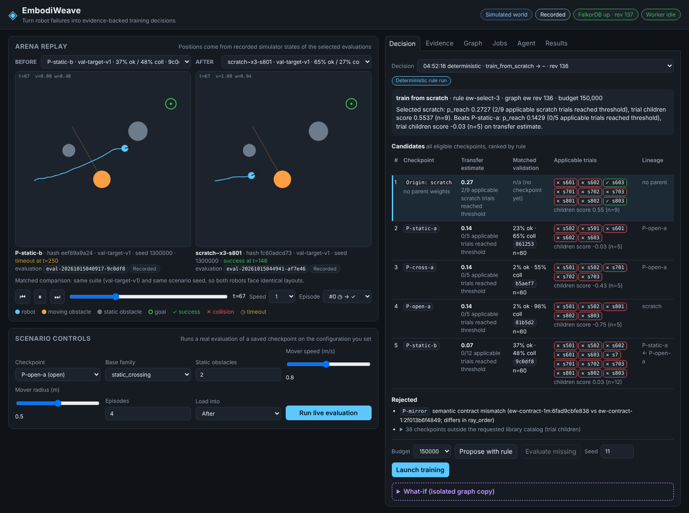

# EmbodiWeave

**GraphHacks 2026, Track 1: Agents That Act on Connected Data.** FalkorDB is the primary database.

EmbodiWeave turns robot failures into evidence-backed training decisions. A simulated mobile robot
fails a new mission (static obstacles plus a crossing pedestrian). An agent queries a FalkorDB graph of
checkpoints, contracts, evaluations, failures and past adaptation trials, decides where to start
training from (an existing checkpoint or scratch), launches real PPO training, measures the result on a
matched validation suite, writes the outcome back to the graph, and asks a promotion gate whether the
new checkpoint may replace the deployed one. The next decision changes when the evidence changes.

Everything is a software simulation. No physical robot is involved.

## What the graph decides, and what it got right

Measured on three fresh final-test suites (details: [`evidence/gate5/RESULTS.md`](evidence/gate5/RESULTS.md)):

| Experiment | Graph rule | Graph picked | Graph arm test success | Latest checkpoint | Best-validation checkpoint |
|---|---|---|---|---|---|
| exp-1 | ew-select-1 | P-static-a | 0.33 | 0.35 | 0.35 |
| exp-2 | ew-select-2 | scratch | **0.71** | 0.39 | 0.39 |
| exp-3 | ew-select-3 | scratch | **0.70** | 0.37 | 0.37 |

exp-1 is a negative result: warm starts from this library plateau, and the first rule could only choose
among parents. The graph's measured transfer history showed that, so scratch became a graph option
(exp-2), and a tie blind spot found after exp-2 was fixed (exp-3). Each rule change was committed
before its experiment and judged on a previously unused test suite. Three seeds per arm: preliminary.

## Graph model

Authored world facts (`ew/graph/ingest.py: init_world`):

```
(:Robot)<-[:FOR_ROBOT]-(:Contract)                    semantic obs/action contract, hashed id
(:Mission)-[:REQUIRES]->(:Competency)-[:REQUIRES]->(:Competency)
(:Suite {role:'validation'|'final_test'})-[:DRAWS_FROM]->(:Family), -[:EVALUATES]->(:Competency)
(:Threshold)-[:MEASURED_ON]->(:Suite)
(:Hypothesis)-[:SUGGESTS]->(:Competency)              authored, labelled measured=false
(:Origin {id:'scratch'})                              the "no parent" option
```

Measured evidence, appended from immutable JSON records under `artifacts/records/`:

```
(:Run)-[:PRODUCED]->(:Policy)-[:USES_CONTRACT]->(:Contract)
(:Run)-[:STARTED_FROM]->(:Policy), (:Run)-[:TRAINED_ON]->(:Family)
(:Policy)-[:DERIVED_FROM]->(:Policy)
(:Evaluation)-[:ASSESSED]->(:Policy), -[:ON_SUITE]->(:Suite)       validation only, exact artifact hash
(:Failure)-[:OBSERVED_IN]->(:Evaluation), (:Hypothesis)-[:ABOUT]->(:Failure)
(:Trial)-[:FROM_PARENT]->(:Policy) | -[:FROM_ORIGIN]->(:Origin)
(:Trial)-[:TARGETS]->(:Family), -[:UNDER_CONTRACT]->(:Contract), -[:PRODUCED]->(:Policy)
(:Trial)-[:VIA_RUN]->(:Run), -[:VALIDATED_ON]->(:Suite)
(:Decision)-[:CONSIDERED|REJECTED]->(:Policy), -[:SELECTED]->(:Policy|:Origin)
(:Decision)-[:BASED_ON]->(:Trial|:Evaluation), -[:LAUNCHED]->(:Run)
(:Promotion)-[:FOR]->(:Policy), -[:USED_EVALUATION]->(:Evaluation)
(:Meta {revision})                                     bumped on every write; cited by decisions
```

The graph can be rebuilt from the records at any time (`ew.graph.ingest.rebuild()`).
Final-test evaluations are never ingested, so no query can leak them into a decision.

## Cypher the agent runs

All decision reads are fixed, parameterized templates (`ew/graph/queries.py`) executed through
`GRAPH.RO_QUERY`, so they cannot write. Each result is logged with its Cypher, parameters, returned
record ids and graph revision, and the studio shows them in the Evidence tab. Highlights:

Compatibility goes beyond tensor shape. The mirrored-ray checkpoint has the same 51-dim input and is
still rejected, with the fields that differ:

```cypher
MATCH (tc:Contract {id:$contract})-[:FOR_ROBOT]->(tr:Robot {id:$robot})
MATCH (p:Policy)-[:USES_CONTRACT]->(pc:Contract)-[:FOR_ROBOT]->(pr:Robot)
OPTIONAL MATCH (run:Run)-[:PRODUCED]->(p)
RETURN p.id AS policy_id, p.artifact_hash AS artifact_hash, p.status AS status,
       pc.id = tc.id AS contract_match, pr.id = tr.id AS robot_match,
       [k IN ['ray_order','n_rays','history','history_reset','dt_s','action_map','normalization']
        WHERE pc[k] <> tc[k]] AS differing_fields
```

Transfer evidence is conditioned on the exact target, contract, recipe, threshold and budget:

```cypher
UNWIND $ids AS pid
MATCH (p:Policy {id:pid})
OPTIONAL MATCH (t:Trial)-[:FROM_PARENT]->(p)
WHERE t.threshold_id = $threshold AND t.recipe = $recipe AND t.budget = $budget
  AND (t)-[:TARGETS]->(:Family {id:$family})
  AND (t)-[:UNDER_CONTRACT]->(:Contract {id:$contract})
RETURN pid AS policy_id, t.id AS trial_id, t.status AS status, t.threshold_reached AS reached,
       t.steps_to_threshold AS steps_to_threshold, coalesce(t.hypothetical, false) AS hypothetical
```

Scratch is an option with its own evidence:

```cypher
MATCH (o:Origin {id:'scratch'})
OPTIONAL MATCH (t:Trial)-[:FROM_ORIGIN]->(o)
WHERE t.threshold_id = $threshold AND t.recipe = $recipe AND t.budget = $budget
  AND (t)-[:TARGETS]->(:Family {id:$family}) AND (t)-[:UNDER_CONTRACT]->(:Contract {id:$contract})
RETURN t.id AS trial_id, t.status AS status, t.threshold_reached AS reached
```

What the trials actually produced (the ew-select-3 tie-breaker):

```cypher
UNWIND $trial_ids AS tid
MATCH (t:Trial {id:tid})-[:PRODUCED]->(c:Policy)
MATCH (s:Suite {id:$suite}) WHERE s.role = 'validation'
OPTIONAL MATCH (e:Evaluation)-[:ASSESSED]->(c)
WHERE (e)-[:ON_SUITE]->(s) AND e.artifact_hash = c.artifact_hash
RETURN tid AS trial_id, e.success_rate AS success_rate, e.collision_rate AS collision_rate
```

Other templates: `mission_requirements` (variable-length `REQUIRES*1..6`), `candidate_ancestry`
(`DERIVED_FROM*0..8`), `matched_validation`, `non_applicable_trials`, `failure_inspection`,
`promotion_evidence`, `decision_provenance`, `policy_lineage_graph`.

## Selection rule

The rule is code, not an LLM opinion (`ew/select.py`, history in its docstring):

1. Eligible = same robot, same semantic contract, completed checkpoint, artifact hash verified on disk.
2. Every eligible candidate needs a matched validation of its exact artifact; otherwise the decision is
   `evaluate_candidates`.
3. p_reach = (reached + 1) / (completed + 2) over conditioned trials. A failed trial counts as "not
   reached within budget"; no steps-to-threshold value is ever invented.
4. ew-select-3 ranks parents and scratch together by p_reach, then the mean validation score of the
   checkpoints their trials produced, then the parent's own validation, then id.

What-if mode copies the graph (`GRAPH.COPY`), applies hypothetical trials or contract changes there,
labels every hypothetical input, refuses writes to production and cannot launch training.

## Agent and tools

`ew/agent_tools.py` exposes 11 bounded tools (inspect mission, read-only query templates, propose,
evaluate candidates, start training, job status, wait, cancel, evaluate checkpoint, request promotion,
export evidence), also served over MCP stdio by `ew/mcp_server.py`. Training runs in a single worker
(`ew/jobs.py`) with idempotency keys, a per-job cap (200k steps), a total quota (3M steps),
cancellation and restart recovery. `start_training` re-runs the rule and refuses a stale decision.

`python -m ew.agent deterministic` runs the full loop over MCP with a scripted policy and is labelled
"Deterministic rule run". `python -m ew.agent llm` runs the same loop with a real LLM choosing the tool calls: Groq (`GROQ_API_KEY`, model `EW_GROQ_MODEL`, default `auto`: the strongest known tool-calling model the account offers, recorded in the trace) or Claude (`ANTHROPIC_API_KEY`). **The LLM mode has not been run yet:** the Groq path is written but this build environment cannot reach api.groq.com. Deterministic runs are never shown as LLM runs.

## Studio

`web/` is a static page served by the FastAPI app (`ew/api.py`): matched before/after replays drawn
from recorded simulator states, scenario controls that run a real evaluation, candidate ranking with
rejection reasons, the Cypher evidence, a live graph view, jobs, agent traces and the results table.
Badges show Recorded, Live or What-if, and a banner appears when the graph is unreachable.



## Run it

Requirements: Linux or macOS with Docker, Python 3.13. No GPU needed (4 CPU cores used here).

```bash
python3.13 -m venv .venv && .venv/bin/pip install -r requirements.lock
bash scripts/start.sh                   # FalkorDB (pinned digest), worker, studio on 127.0.0.1:8000
.venv/bin/python -m pytest -q           # 37 tests, needs FalkorDB on localhost:6379
```

To rebuild the evidence from nothing: `scripts/build_library.py`, `scripts/gate2_demo.py`,
`scripts/experiment.py`, `scripts/backfill_scratch_trials.py`, `scripts/experiment2.py`,
`scripts/experiment3.py`. A spent final-test suite is refused, so rerunning an experiment needs a fresh
artifacts directory (`EW_ARTIFACTS=/path`).

## Limitations

- 2D kinematic simulator with ray sensors, not a physics engine or real robot.
- Three training seeds per arm and 150k-step budgets. No arm met the full test threshold (collision
  stayed near 0.18 against a 0.10 limit).
- The library is small (5 checkpoints) and was trained with short budgets, which is partly why reuse
  lost. A single-seed diagnostic suggests the parents' low exploration noise limits adaptation.
- The selection rule was revised twice after seeing results; see `evidence/gate5/RESULTS.md`.

## Evidence

Per-gate commands and outputs: [`evidence/GATES.md`](evidence/GATES.md). Readiness and rule checks:
[`evidence/gate0/readiness.md`](evidence/gate0/readiness.md). Demo script: [`docs/demo-script.md`](docs/demo-script.md).

## Documents, dates and AI disclosure

- `docs/v2-original/prd.md` and `spec.md` are dated 14 October 2026, before the event started. They
  are pre-event planning material and are included unchanged (sha256 in `evidence/gate0/readiness.md`).
- All code, training runs and results were produced after kickoff, on 15 October 2026 (git history).
- AI tool disclosure: the code, experiments and documentation were written with Claude Code
  (Anthropic) acting as the coding agent, directed by the project owner. The runtime agent in
  `ew/agent.py` can use the Claude API when a key is configured.

## Acknowledgements

FalkorDB, Stable-Baselines3, Gymnasium, PyTorch, FastAPI, the Model Context Protocol Python SDK and the
Anthropic Python SDK. License: not yet chosen by the owner.
